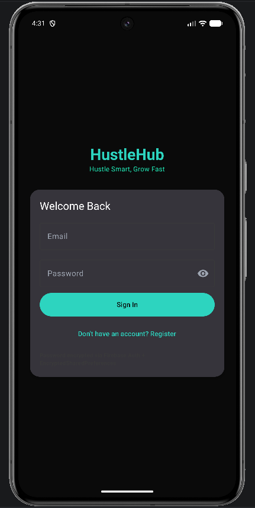
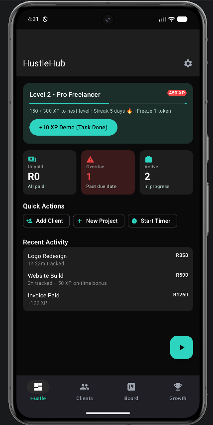
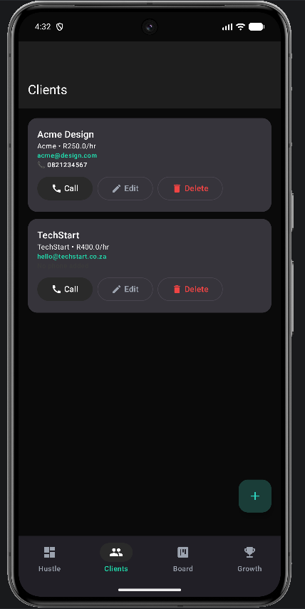
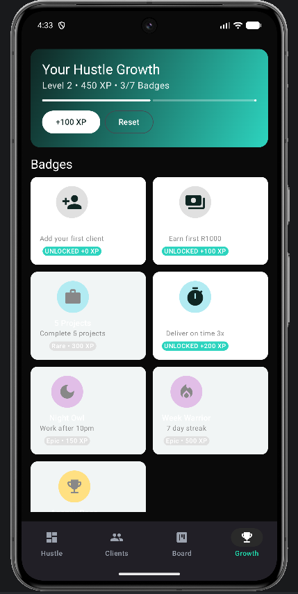
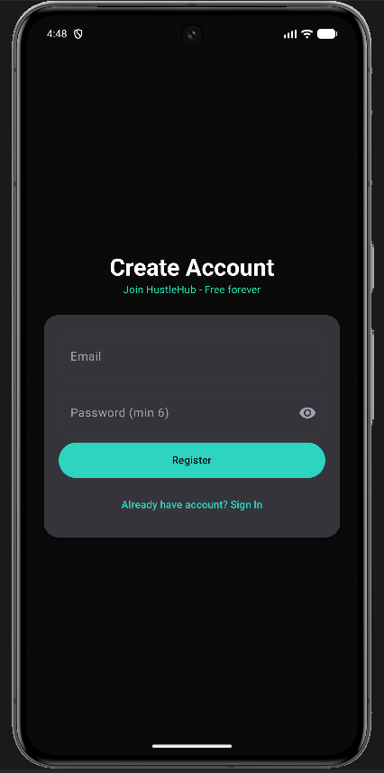
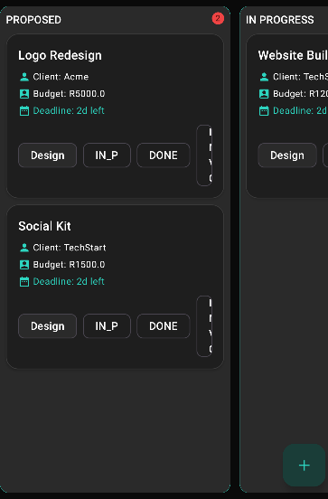
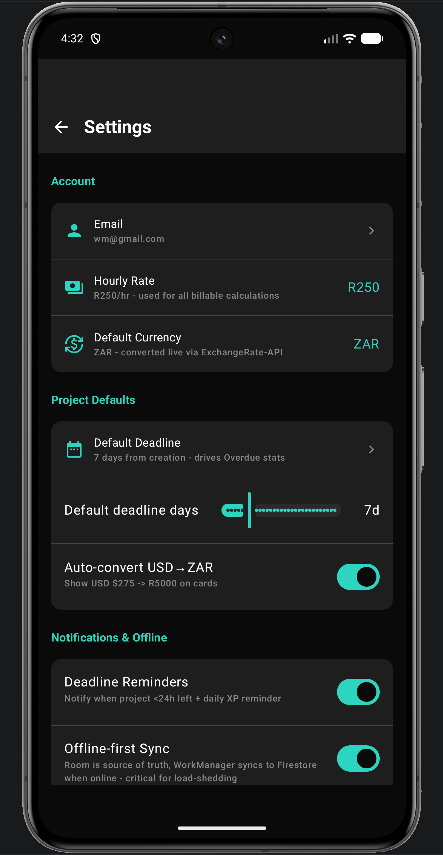

# 🚀 HustleHub - Freelance Business Manager
### *Hustle Smart, Grow Fast*

> **Professional Business Tool** | Platform: Android (Kotlin + Jetpack Compose)

[[Kotlin](https://img.shields.io/badge/Kotlin-2.0-purple?logo=kotlin)](https://kotlinlang.org/)
[[Jetpack Compose](https://img.shields.io/badge/Jetpack%20Compose-Material3-4285F4?logo=jetpackcompose)](https://developer.android.com/jetpack/compose)
[[Firebase](https://img.shields.io/badge/Firebase-Auth%20%2B%20Firestore%20%2B%20FCM-FFCA28?logo=firebase)](https://firebase.google.com/)
[[Room](https://img.shields.io/badge/Room-Offline--First-003B57?logo=android)](https://developer.android.com/training/data-storage/room)

HustleHub is an offline-first freelance business manager designed to help you stay organized and get paid. It combines client management, Kanban project tracking, billable time tracking, PDF invoicing, robust calculator tools, and gamification to keep you productive and motivated.

**Product Demo:** [▶️ Watch Demo on YouTube](https://youtu.be/MQVb-npr1_w)

---

## 📸 Screenshots

| Login & Register | Dashboard & Kanban | Clients & Settings | Growth & Badges |
| :---: | :---: | :---: | :---: |
|  |  |  |  |
|  |  |  | |

---

## ✨ Core Features

### 1. Secure Authentication & Real-Time Sync
- **Modern Onboarding:** Dedicated Login & Register flows with Material 3 charcoal+teal design.
- **Enhanced Security:** Firebase Authentication (Email/Password & Google SSO) with token-based local persistence via **EncryptedSharedPreferences**.
- **Cloud Sync:** Stores user profile data and FCM push notification tokens securely in Firestore.

### 2. Kanban Project Board
- **5-Stage Workflow:** Track progress from Proposal to Payment (PROPOSED, IN_PROGRESS, DONE, INVOICED, PAID).
- **Interactive Layout:** Quick-move status chips for seamless project management.
- **Smart Monitoring:** Real-time tracking of deadlines and task progress.
- **Overdue Alerts:** Automated visual cues for projects nearing or past their deadlines.

### 3. Professional Invoicing, Timer & Calculator
- **Time Tracking:** Integrated Foreground Service timer to record billable hours accurately.
- **Advanced Invoice Calculator:** Dedicated tool to instantly calculate Subtotals, Tax/VAT, and Extra Expenses based on your tracked hours.
- **PDF Generation:** One-click invoice creation pulling real-time data from project metrics.

### 4. Global Currency & Localization Support 🌍
- **Multi-Currency System:** Dynamically toggle between 5 major currencies (**ZAR**, **USD**, **EUR**, **GBP**, **AUD**) across budgets, calculators, and settings.
- **Multi-Language Support (I18N):** Fully localized interface supporting 5 languages: **English (EN)**, **Afrikaans (AF)**, **isiXhosa (XH)**, **Spanish (ES)**, and **French (FR)**. Seamlessly switches app-wide on the fly.

### 5. Client Management
- **Full CRM Capabilities:** Add, edit, and manage client profiles with detailed contact info.
- **One-Tap Contact:** Integrated call functionality using Android Intents for immediate client outreach.

### 6. Dynamic Dashboard
- **Business Intelligence:** Live calculation of unpaid invoices, overdue projects, and active workloads.
- **Productivity Metrics:** Visual indicators for current levels, streaks, and upcoming tasks.
- **Actionable Insights:** Quick-access buttons for the most common freelance workflows.

### 7. Gamification & Growth
- **Engagement Engine:** Level-up system based on business milestones and productivity.
- **Badge Achievement:** 7 unlockable badges with rarity tiers and animated unlock states.
- **Streak System:** Maintain daily activity streaks with "Freeze Token" protection.

### 8. Firebase Push Notifications 🔔
- **Cloud Messaging Integration:** Fully integrated with Firebase Cloud Messaging (FCM) to receive broadcast messages and targeted alerts.
- **Deadline Reminders:** System-level heads-up notifications with sounds and vibrations.
- **Token Management:** Automatically syncs device FCM tokens to Firestore on login and app start.

---

## 🛠 Tech Stack

| Layer | Technology |
| :--- | :--- |
| **UI** | Jetpack Compose (Material 3) |
| **Auth** | Firebase Auth (Email/Pass & Google SSO) + EncryptedSharedPreferences |
| **Local Data** | Room Persistence Library (Offline-First) |
| **Cloud Sync** | Google Firestore |
| **Push Notifications**| Firebase Cloud Messaging (FCM) |
| **External APIs** | ExchangeRate-API (Financial) & ZenQuotes (Motivation) |
| **Operations** | WorkManager (Background Tasks) & Foreground Services |
| **Networking** | Retrofit + OkHttp |

---

## 🏗 Architecture

HustleHub follows **Clean Architecture** principles with an **MVVM** (Model-View-ViewModel) pattern, ensuring a scalable and testable codebase.

- **Offline-First:** Room acts as the single source of truth, with WorkManager handling asynchronous synchronization with Firestore.
- **Reactive UI:** Compose screens observe state changes via StateFlows, ensuring a fluid user experience.

---

## 📦 Installation & Setup

### Prerequisites
- Android Studio (Latest Version)
- JDK 17+
- A Firebase Project (with Authentication, Firestore, and Cloud Messaging enabled)

### Steps
1. **Clone the repository:**
   ```bash
   git clone https://github.com/Wasama1904/hustlehub.git
   ```

2. **Configure Firebase:**
   - Add your `google-services.json` to the `app/` directory.
   - Enable Email/Password Auth, Google Sign-In, and Firestore in the Firebase Console.

3. **Set API Keys:**
   Create a `local.properties` file in the root directory:
   ```properties
   EXCHANGE_RATE_API_KEY=your_key_here
   ```

4. **Build and Run:**
   Sync Gradle and deploy the `:app` module to your device or emulator.

---

## 🚧 Roadmap

- [ ] Material 3 DatePicker migration
- [ ] Actionable timer notifications
- [ ] Financial growth charting
- [ ] CSV/Excel data export

---

## 👤 Author

**Wasama Makolo**
IT and Software Developer
Cape Town, South Africa 🇿🇦
